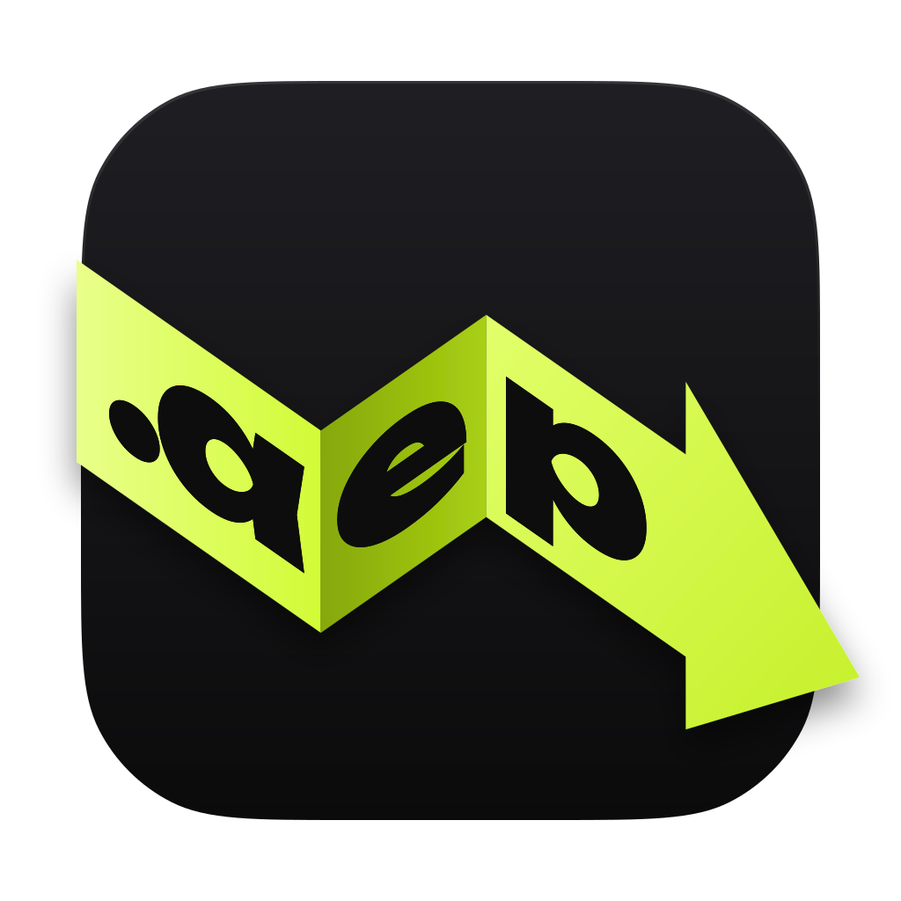
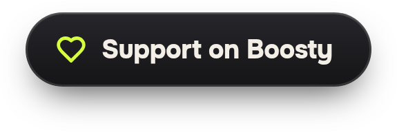
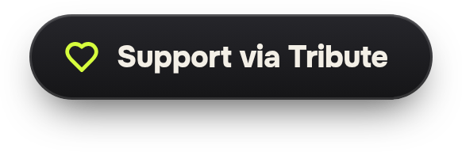
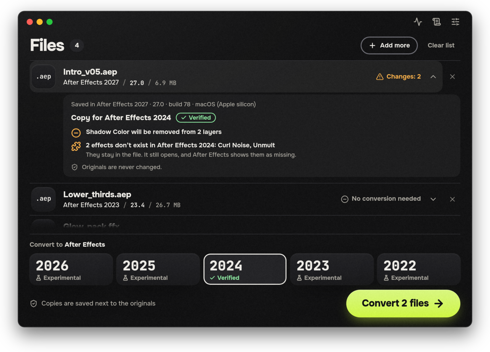
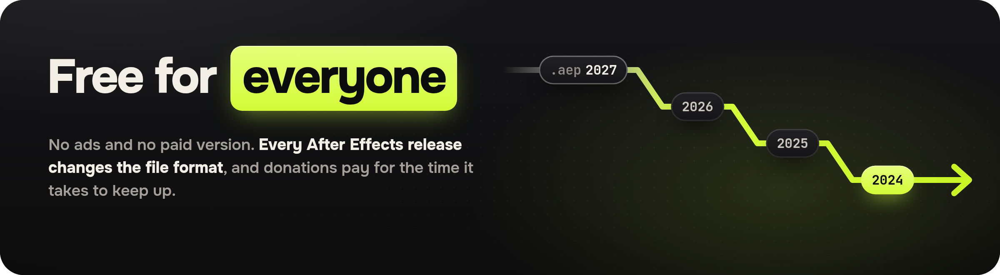

<div align="center">
  
  <h1>AEP Downgrader</h1>
  <p><strong>Open newer After Effects projects in older versions of After Effects.</strong></p>
  <p>Windows, macOS and Linux. Free and open source.</p>
  <p>
    <a href="https://aepdowngrader.com"></a>
    <a href="https://boosty.to/aepdowngrader"></a>
    <a href="https://web.tribute.tg/d/UNE"></a>
  </p>
  <p>
    <a href="https://github.com/itsAnchorpoint/AEP-Downgrader/releases/latest"></a>
    <a href="https://github.com/itsAnchorpoint/AEP-Downgrader/releases"></a>
    <a href="https://aepdowngrader.com"></a>
    <a href="LICENSE"></a>
  </p>
  <p><a href="README.ru.md">По-русски</a></p>
  
</div>

AEP Downgrader makes a copy of an After Effects project (`.aep`), template (`.aet`) or animation preset (`.ffx`) that an older After Effects can open. It makes the same changes After Effects makes in **File > Save As > Save a Copy As** for an older version, so you don't need the newer After Effects installed.

## Your projects stay on your computer

- Files are read and written on your computer only. Nothing is uploaded.
- There is no account and no telemetry.
- The only network request the app makes is the update check: at most once a day it reads a small file about the latest release from GitHub. You can turn it off in Settings. An update is installed only when you click **Update**, and only if its signature matches.
- The source code is open, so you can check all of this. Details: [docs/PRIVACY.md](docs/PRIVACY.md).

## Download

Get the app from [aepdowngrader.com](https://aepdowngrader.com) or from the [latest release](https://github.com/itsAnchorpoint/AEP-Downgrader/releases/latest):

| System | File |
|---|---|
| Windows | Installer (`…_x64-setup.exe`), or the portable app (`…_x64-portable.exe`): no installation, settings are kept next to it |
| macOS, Intel and Apple silicon | Disk image (`….dmg`) |
| Linux | AppImage, or a `.deb` package |

Each release also has `SHA256SUMS.txt` and [build provenance attestations](https://github.com/itsAnchorpoint/AEP-Downgrader/attestations), so you can check that a file was built from this repository by GitHub Actions.

## First launch

The app isn't code-signed yet, so Windows and macOS warn you the first time you open it.

**Windows**

1. Your browser may say the file isn't commonly downloaded. Choose to keep it.
2. When you open it, SmartScreen says "Windows protected your PC". Click **More info**, then **Run anyway**.

**macOS**

1. Safari may ask whether to allow downloads from GitHub. Click **Allow**.
2. Open the disk image and drag AEP Downgrader to Applications.
3. Open the app. macOS says it was "Not Opened". Click **Done**, not Move to Trash.
4. Open **System Settings > Privacy & Security**, scroll down to the message about AEP Downgrader and click **Open Anyway**. Enter your password. The app opens, and macOS won't ask again.

**Linux**

- AppImage: make the file executable (`chmod +x AEP.Downgrader_*.AppImage`, or allow executing it in the file's properties), then run it.
- `.deb`: `sudo apt install ./AEP.Downgrader_*_amd64.deb`.
- On NVIDIA graphics under Wayland, the AppImage draws its window through XWayland, because its bundled WebKitGTK is slow there. Text may look a little softer. If you set `GDK_BACKEND` yourself, the app keeps your value. The `.deb` uses your system's WebKitGTK and draws natively.

## How to use it

1. Drop files or a whole folder onto the window, or click to choose files (Ctrl+O, ⌘O on a Mac).
2. Each file shows which After Effects version saved it.
3. Under **Convert to**, pick the version you need. Only versions older than the file are offered, and each one is marked **Verified** or **Experimental** (see [Compatibility](#compatibility)).
4. Each file says in a word what will happen: **Nothing lost**, **Changes: 2**, or **Can't convert**. **Show report** lists the changes before anything is written.
5. Click **Convert** (Ctrl+Enter, ⌘↩ on a Mac). Copies are saved next to the originals, named like `project_AE2024.aep`. Originals are never changed.

In Settings you can choose another folder for copies, change the file name pattern, and decide what happens when a file with that name already exists.

## Compatibility

A target is **Verified** only if converted files were opened in a real After Effects of that version. Otherwise it is **Experimental**, even when the copy matches what After Effects itself writes.

| Target | Status | Basis |
|---|---|---|
| After Effects 2026 (26.x) | Experimental | Matches the file After Effects 27.0 saves for 26.x except color settings of sources. Not yet opened in After Effects 2026. |
| After Effects 2025 (25.x) | Experimental | Matches the file After Effects 27.0 saves for 25.x except one migrated effect. Not yet opened in After Effects 2025. |
| After Effects 2024 (24.x) | Verified | Projects from 25.6 and 26.0 opened in After Effects 24.5. |
| After Effects 2023 (23.x) | Experimental | Matches the file After Effects 24.5 saves for 23.x except panel state. Not yet opened in After Effects 2023. |
| After Effects 2022 (22.x) | Experimental | Matches the file After Effects 24.5 saves for 22.x. Not yet opened in After Effects 2022. |

Files saved by After Effects 2023 to 2027 can be converted. The full explanation, and what blocks a conversion: [docs/COMPATIBILITY.md](docs/COMPATIBILITY.md).

## What changes, and what can be lost

- A conversion can't add anything. Effects and features that exist only in the newer version don't appear in the older one. The report lists what will be removed before you convert.
- Third-party plugins stay in the file, but the older After Effects needs them installed too, or it shows them as missing.
- After Effects 2022 can't use a track matte that isn't the layer directly above the layer that uses it. Such a file isn't converted to 2022. Choose 2023 or newer, or move each matte layer directly above its layer.
- Keep your originals, especially when you convert to an Experimental version.

## Updates

The app checks for a new version at most once a day. You can turn this off, or check by hand, in Settings. When there is one, a bar at the top of the window says so, and **What's new** shows the release notes. **Update** downloads the new version, checks its signature and installs it. After the restart the app shows what changed since the version you had.

The Windows installer and portable app, the macOS app and the Linux AppImage update themselves. The `.deb` package doesn't: the app opens the release page instead.

## Support the project

<a href="https://aepdowngrader.com/support"></a>

<p align="center">
  <a href="https://boosty.to/aepdowngrader"></a>
  <a href="https://web.tribute.tg/d/UNE"></a>
</p>

If the app saved you a deadline, you can support it:

- [Boosty](https://boosty.to/aepdowngrader): bank cards, including cards from outside Russia.
- [Tribute](https://web.tribute.tg/d/UNE): bank cards from any country. Works in the browser or [in Telegram](https://t.me/tribute/app?startapp=dUNE).

If your bank declines the payment on one, try the other. Both on one page: [aepdowngrader.com/support](https://aepdowngrader.com/support).

## How to help

- **Run the tester kit.** The maintainer only has After Effects 2024, so the other versions stay Experimental until someone opens converted files in them. The kit is a few scripts that build a small test project with nothing personal in it: [tools/ae/README.md](tools/ae/README.md).
- **Report a file the app doesn't recognize**, or a conversion that fails, by [opening an issue](https://github.com/itsAnchorpoint/AEP-Downgrader/issues). Say which After Effects version and system saved it. **Don't attach a confidential project.** Say that you have such a file, and a private way to send it can be arranged. Project files contain the paths of your footage, so treat them as private.
- **Contribute code.** See [CONTRIBUTING.md](CONTRIBUTING.md).

Thank you to the volunteers who tested. Special thanks to Shiiru, who supplied files from After Effects 27.0 on macOS, and to Павел Бизонов, who supplied files from After Effects 26.2 on macOS.

## Command line

The `aep` tool does the same work from a terminal. Build it with `cargo build --release -p aep-cli`, or run it through `cargo run -p aep-cli --`.

```text
aep targets <file>                      which versions this file can be converted to
aep convert <in> <out> --to <major>     convert (24 means After Effects 2024); refuses to overwrite <out>
aep compat                              print the compatibility table
aep tree <file>                         print the chunk tree of a project
aep roundtrip <file>                    check that the file parses and writes back byte for byte
aep diff [--full] [--no-noise] <a> <b>  structural difference between two projects
```

## Build from source

You need Rust (stable), Node.js 22 and pnpm. On Linux you also need the WebKitGTK development packages (see `.github/workflows/ci.yml` for the list).

```bash
git clone https://github.com/itsAnchorpoint/AEP-Downgrader.git
cd AEP-Downgrader

# core and command line
cargo test

# desktop app
cd apps/desktop
pnpm install
pnpm tauri dev      # run
pnpm tauri build    # installers for your system
```

## For developers

How the file format works and how the conversion rules were found: [docs/FORMAT.md](docs/FORMAT.md). How the app and its assets should look: [docs/DESIGN.md](docs/DESIGN.md). Terms and style of the texts: [docs/WRITING.md](docs/WRITING.md).

## License and trademarks

GNU General Public License v3.0. See [LICENSE](LICENSE).

Adobe and After Effects are trademarks of Adobe. This project is not affiliated with, endorsed by or sponsored by Adobe.
