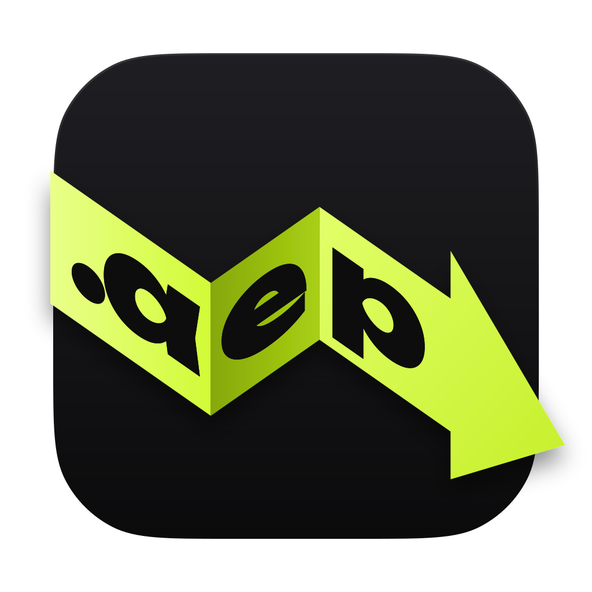
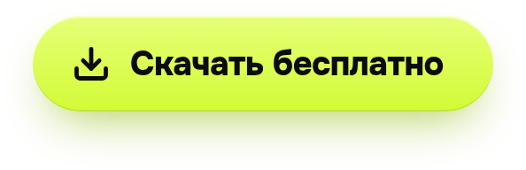
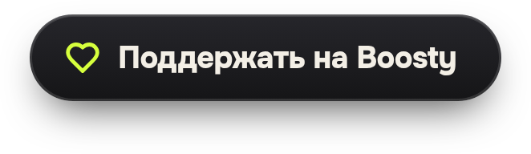
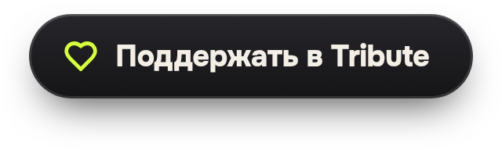
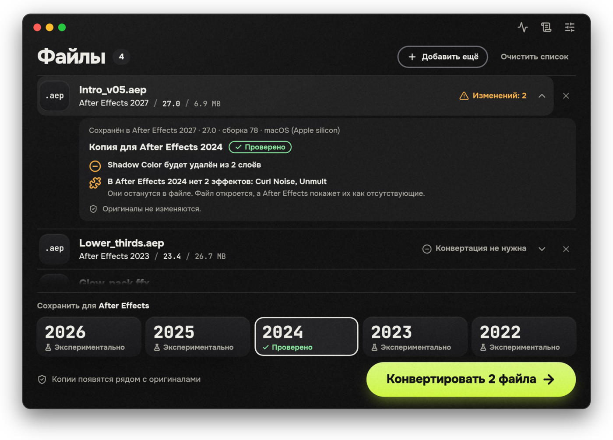
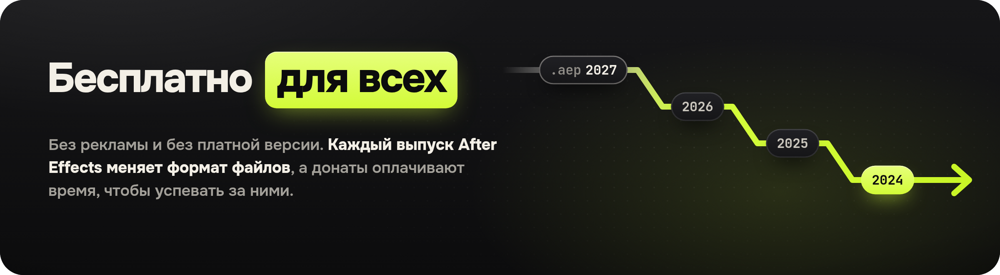

<div align="center">
  
  <h1>AEP Downgrader</h1>
  <p><strong>Открывайте проекты новых After Effects в старых версиях.</strong></p>
  <p>Windows, macOS и Linux. Бесплатно и с открытым кодом.</p>
  <p>
    <a href="https://aepdowngrader.com/ru/"></a>
    <a href="https://boosty.to/aepdowngrader"></a>
    <a href="https://web.tribute.tg/d/UNE"></a>
  </p>
  <p>
    <a href="https://github.com/itsAnchorpoint/AEP-Downgrader/releases/latest"></a>
    <a href="https://github.com/itsAnchorpoint/AEP-Downgrader/releases"></a>
    <a href="https://aepdowngrader.com/ru/"></a>
    <a href="LICENSE"></a>
  </p>
  <p><a href="README.md">English</a></p>
  
</div>

AEP Downgrader делает копию проекта (`.aep`), шаблона (`.aet`) или пресета анимации (`.ffx`) After Effects, которую откроет более старая версия After Effects. Он вносит те же изменения, что и сам After Effects в **File > Save As > Save a Copy As** для старой версии, поэтому новый After Effects для этого не нужен.

## Проекты остаются на вашем компьютере

- Файлы читаются и записываются только на вашем компьютере. Никуда не загружаются.
- Аккаунта и телеметрии нет.
- В интернет приложение выходит только для проверки обновлений: не чаще раза в день оно читает с GitHub небольшой файл о последней версии. Проверку можно выключить в настройках. Обновление ставится, только когда вы нажмёте «Обновить», и только если его подпись совпала.
- Код открыт, всё это можно проверить. Подробно: [docs/PRIVACY.md](docs/PRIVACY.md) (по-английски).

## Скачать

Приложение есть на [aepdowngrader.com](https://aepdowngrader.com/ru/) и на странице [последнего релиза](https://github.com/itsAnchorpoint/AEP-Downgrader/releases/latest):

| Система | Файл |
|---|---|
| Windows | Установщик (`…_x64-setup.exe`) или портативная версия (`…_x64-portable.exe`): без установки, настройки хранятся рядом с ней |
| macOS, Intel и Apple silicon | Образ диска (`….dmg`) |
| Linux | AppImage или пакет `.deb` |

В каждом релизе есть `SHA256SUMS.txt` и [аттестации сборки](https://github.com/itsAnchorpoint/AEP-Downgrader/attestations): по ним можно проверить, что файл собран из этого репозитория в GitHub Actions.

## Первый запуск

У приложения пока нет цифровой подписи, поэтому Windows и macOS предупреждают при первом запуске.

**Windows**

1. Браузер может сказать, что этот файл редко скачивают. Выберите «Сохранить».
2. При запуске появится окно «Система Windows защитила ваш компьютер». Нажмите «Подробнее», затем «Выполнить в любом случае».

**macOS**

1. Safari может спросить, разрешить ли загрузки с GitHub. Нажмите «Разрешить».
2. Откройте образ диска и перетащите AEP Downgrader в «Программы».
3. Откройте приложение. macOS покажет окно о том, что файл «не был открыт». Нажмите «Готово», а не «Переместить в Корзину».
4. Откройте «Системные настройки» → «Конфиденциальность и безопасность», прокрутите вниз до сообщения об AEP Downgrader и нажмите «Все равно открыть». Введите пароль. Приложение откроется, и больше macOS спрашивать не будет.

**Linux**

- AppImage: сделайте файл исполняемым (`chmod +x AEP.Downgrader_*.AppImage` или разрешите запуск в свойствах файла) и запустите.
- `.deb`: `sudo apt install ./AEP.Downgrader_*_amd64.deb`.
- На видеокартах NVIDIA под Wayland AppImage рисует окно через XWayland: встроенный в него WebKitGTK там тормозит. Текст может выглядеть чуть мягче. Если вы сами задали `GDK_BACKEND`, приложение оставит ваше значение. Пакет `.deb` использует системный WebKitGTK и рисует окно напрямую.

## Как пользоваться

1. Перетащите в окно файлы или целую папку либо нажмите, чтобы выбрать файлы (Ctrl+O, на Mac ⌘O).
2. У каждого файла видно, какой версией After Effects он сохранён.
3. В строке «Сохранить для» выберите нужную версию. Предлагаются только версии старше файла, и у каждой есть пометка «Проверено» или «Экспериментально» (см. [Совместимость](#совместимость)).
4. У каждого файла одним словом сказано, что будет: «Без потерь», «Изменений: 2» или «Нельзя конвертировать». Кнопка «Показать отчёт» перечислит изменения, пока ещё ничего не записано.
5. Нажмите «Конвертировать» (Ctrl+Enter, на Mac ⌘↩). Копии сохраняются рядом с оригиналами, с именами вроде `project_AE2024.aep`. Оригиналы не меняются никогда.

В настройках можно выбрать другую папку для копий, поменять шаблон имени файла и решить, что делать, если файл с таким именем уже есть.

## Совместимость

Версия получает статус «Проверено», только если сконвертированные файлы открывали в настоящем After Effects этой версии. Иначе она «Экспериментально», даже если копия совпадает с тем, что пишет сам After Effects.

| Версия | Статус |
|---|---|
| After Effects 2026 | Экспериментально |
| After Effects 2025 | Экспериментально |
| After Effects 2024 | Проверено |
| After Effects 2023 | Экспериментально |
| After Effects 2022 | Экспериментально |

Конвертировать можно файлы из After Effects 2023–2027. На чём основан каждый статус и что мешает конвертации: [docs/COMPATIBILITY.md](docs/COMPATIBILITY.md) (по-английски).

## Что меняется и что может потеряться

- Конвертация ничего не добавляет. Эффекты и возможности, которые есть только в новой версии, в старой не появятся. Ещё до конвертации отчёт покажет, что будет удалено.
- Сторонние плагины остаются в файле, но их нужно установить и в старый After Effects, иначе он покажет их как отсутствующие.
- After Effects 2022 не понимает слой-маску, которая лежит не прямо над слоем, использующим её. Такой файл в 2022 не конвертируется. Выберите 2023 или новее либо поставьте каждую маску прямо над её слоем.
- Храните оригиналы, особенно если конвертируете в экспериментальную версию.

## Обновления

Приложение проверяет новую версию не чаще раза в день. Проверку можно выключить или запустить вручную в настройках. Когда выйдет новая версия, сверху в окне появится полоса, а «Что нового» покажет описание. «Обновить» скачивает новую версию, проверяет её подпись и устанавливает. После перезапуска приложение покажет, что изменилось с вашей версии.

Установщик и портативная версия для Windows, приложение для macOS и AppImage для Linux обновляются сами. Пакет `.deb` нет: приложение откроет страницу релиза.

## Поддержать проект

<a href="https://aepdowngrader.com/ru/support"></a>

<p align="center">
  <a href="https://boosty.to/aepdowngrader"></a>
  <a href="https://web.tribute.tg/d/UNE"></a>
</p>

Если программа выручила вас перед дедлайном, её можно поддержать:

- [Boosty](https://boosty.to/aepdowngrader): банковские карты, в том числе выпущенные не в России.
- [Tribute](https://web.tribute.tg/d/UNE): банковские карты любых стран. Работает в браузере и [в Telegram](https://t.me/tribute/app?startapp=dUNE).

Если банк отклонил платёж на одной площадке, попробуйте другую. Обе на одной странице: [aepdowngrader.com/ru/support](https://aepdowngrader.com/ru/support).

## Как помочь

- **Запустите тест-кит.** У автора есть только After Effects 2024, поэтому остальные версии остаются экспериментальными, пока кто-нибудь не откроет в них сконвертированные файлы. Тест-кит состоит из нескольких скриптов, которые собирают небольшой тестовый проект, в котором нет ничего личного: [tools/ae/README.ru.md](tools/ae/README.ru.md).
- **Сообщите о файле, который приложение не узнаёт** или не может сконвертировать: [откройте issue](https://github.com/itsAnchorpoint/AEP-Downgrader/issues). Напишите, какая версия After Effects и какая система его сохранили. **Не прикладывайте конфиденциальный проект.** Достаточно сказать, что такой файл есть, и мы договоримся, как передать его приватно. В проектах записаны пути к вашим исходникам, так что относитесь к ним как к личным данным.
- **Помогите с кодом.** См. [CONTRIBUTING.md](CONTRIBUTING.md) (по-английски).

Спасибо волонтёрам, которые тестировали. Отдельное спасибо Shiiru за файлы из After Effects 27.0 на macOS и Павлу Бизонову за файлы из After Effects 26.2 на macOS.

## Командная строка

Утилита `aep` делает то же самое из терминала. Соберите её командой `cargo build --release -p aep-cli` или запускайте через `cargo run -p aep-cli --`.

```text
aep targets <file>                      в какие версии можно сконвертировать файл
aep convert <in> <out> --to <major>     сконвертировать (24 — это After Effects 2024); не перезаписывает <out>
aep compat                              вывести таблицу совместимости
aep tree <file>                         вывести дерево чанков проекта
aep roundtrip <file>                    проверить, что файл разбирается и собирается обратно байт в байт
aep diff [--full] [--no-noise] <a> <b>  структурная разница между двумя проектами
```

## Сборка из исходников

Нужны Rust (stable), Node.js 22 и pnpm. На Linux ещё пакеты разработки WebKitGTK (список в `.github/workflows/ci.yml`).

```bash
git clone https://github.com/itsAnchorpoint/AEP-Downgrader.git
cd AEP-Downgrader

# ядро и командная строка
cargo test

# приложение
cd apps/desktop
pnpm install
pnpm tauri dev      # запуск
pnpm tauri build    # установщики для вашей системы
```

## Для разработчиков

Как устроен формат файла и как найдены правила конвертации: [docs/FORMAT.md](docs/FORMAT.md). Как должны выглядеть приложение и его материалы: [docs/DESIGN.md](docs/DESIGN.md). Термины и стиль текстов: [docs/WRITING.md](docs/WRITING.md). Всё по-английски.

## Лицензия и товарные знаки

GNU General Public License v3.0, см. [LICENSE](LICENSE).

Adobe и After Effects — товарные знаки Adobe. Проект не связан с Adobe, Adobe его не одобряла и не спонсирует.
